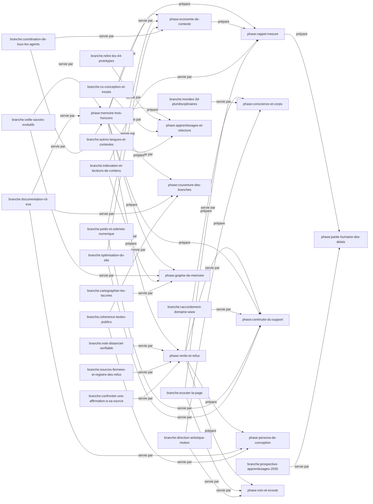

# Graphe de la mémoire d'ÉVA

Dérivé de `plan.toml`, `portefeuille.toml` et `avancees.toml` par
`python3 outils/memoire-eva.py --regenerer`. Ne rien éditer ici.

Le détail fichier par fichier est dans `graphe.dot`.
